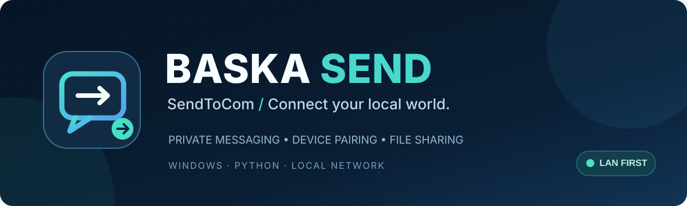

<p align="center"></p>

<p align="center">
<a href="https://github.com/baska-pro/sendtocom/actions/workflows/ci.yml"></a>
<a href="LICENSE"></a>


<a href="https://github.com/baska-pro/sendtocom/releases"></a>
</p>

<p align="center"><strong>Pesan, notifikasi dan transfer file untuk perangkat di jaringan lokal.</strong><br>
A lightweight, single-file Python LAN messaging and file-sharing hub for Windows.</p>

## ✨ Tentang proyek

**BASKA SEND** (repository **SendToCom**) memungkinkan PC Windows menerima dan mengirim pesan serta file melalui browser HP/laptop pada jaringan lokal yang sama. Antarmuka dan backend disertakan dalam satu skrip Python. Tidak dibutuhkan cloud atau akun layanan pihak ketiga.

### Fitur

- **Private chat & ruang umum** — pesan, balasan, dan status terkirim/diterima/dibuka/dibalas.
- **File sharing** — unggah dokumen dan gambar yang diizinkan, drag-and-drop, paste gambar, serta pratinjau file.
- **Keamanan akses** — PIN utama/perangkat, pairing QR/kode sementara, pencabutan dan blokir perangkat.
- **Windows notifications** — popup interaktif, suara, pilihan balas/copy/tutup, dan system tray.
- **WebApp responsif** — pengalaman browser HP dan PC, tema gelap/terang.
- **Penyimpanan lokal** — SQLite, folder penerimaan terorganisir, pengaturan dan log pada PC host.
- **Tanpa dependencies wajib** — Python standard library, dengan Pillow sebagai akselerasi opsional.

> [!WARNING]
> **Gunakan di LAN tepercaya saja.** Server memakai HTTP biasa (tanpa TLS). Jangan port-forward `8765`, mengeksposnya ke internet, atau menganggap PIN cukup untuk melindungi lalu lintas pada Wi-Fi publik. Baca [SECURITY.md](SECURITY.md).

## 🖥️ Persyaratan

| Komponen | Kebutuhan |
|---|---|
| Host | Windows 10/11 (target utama) |
| Runtime | Python 3.10+ |
| Client | Browser modern pada LAN yang sama |
| Paket wajib | Tidak ada |
| Port default | TCP `8765` |
| Data | SQLite dan folder lokal |

> Komponen native popup/tray memerlukan Windows. CI juga menguji kompatibilitas kode inti di Linux, bukan mengklaim semua fitur desktop berjalan di Linux. Belum ada installer EXE resmi.

## 🚀 Instalasi cepat

1. Unduh `SendToCom.py` dari repo atau [Releases](https://github.com/baska-pro/sendtocom/releases).
2. Buka PowerShell/CMD di folder file, kemudian jalankan:

```powershell
py -3 SendToCom.py --setup
```

3. Buat PIN utama ketika diminta. Setup mencoba memasang auto-start Windows dan rule Windows Firewall profil **Private**.
4. Lihat alamat LAN, misalnya `http://192.168.1.10:8765`, kemudian buka dari browser HP atau laptop dalam jaringan yang sama.
5. Login/pair perangkat melalui WebApp.

Jika `py` tidak tersedia, gunakan `python`. Rule firewall mungkin memerlukan PowerShell sebagai Administrator; **jangan** memperbolehkan akses dari profil Public.

**Panduan:** [Instalasi lengkap](docs/INSTALLATION.md) · [Troubleshooting](docs/TROUBLESHOOTING.md) · [Arsitektur](docs/ARCHITECTURE.md)

## ⌨️ Perintah

```powershell
python SendToCom.py --setup
python SendToCom.py --status
python SendToCom.py --run
python SendToCom.py --restart
python SendToCom.py --stop
python SendToCom.py --install-startup
python SendToCom.py --remove-startup
python SendToCom.py --firewall-add
python SendToCom.py --firewall-remove
python SendToCom.py --help
```

Penggantian PIN tersedia melalui opsi `--set-pin`; hindari menyertakan PIN dalam screenshot, log, atau riwayat perintah shell.

## 📁 Penyimpanan

Pada Windows, konfigurasi/SQLite/log berada di `%LOCALAPPDATA%\SendToCom\`. Berkas yang diterima secara default disimpan ke `%USERPROFILE%\Downloads\BASKA SEND\`. Lokasi penerimaan dapat diubah di pengaturan.

Jangan commit **config.json, messages.db, FIRST_RUN_PIN.txt, log, isi pesan, atau file pengguna**. Pola `.gitignore` membantu, tetapi tidak bisa membersihkan berkas sensitif yang terlanjur masuk Git history.

## 🛠️ Pengembangan

```bash
python -m py_compile SendToCom.py
python -m unittest discover -s tests -v
python SendToCom.py --help
```

Perbaikan keamanan dan perubahan kode inti harus ditinjau, diuji pada Windows, dan dijelaskan dalam PR. Lihat [CONTRIBUTING.md](CONTRIBUTING.md) serta [CODE_OF_CONDUCT.md](CODE_OF_CONDUCT.md).

## 📦 Versi & rilis

Versi aplikasi yang tersedia pada source awal adalah **2.2.4**. GitHub Actions menyiapkan source ZIP dan checksum SHA-256 ketika tag `vX.Y.Z` dibuat, dengan pemeriksaan kesesuaian nomor versi. Detail di [Panduan Rilis](docs/RELEASING.md) dan [CHANGELOG.md](CHANGELOG.md).

## 📜 Lisensi

[MIT License](LICENSE) © 2026 [BASKA PRO](https://github.com/baska-pro). Kode terbuka tidak otomatis memberikan hak merek terhadap identitas BASKA PRO.
